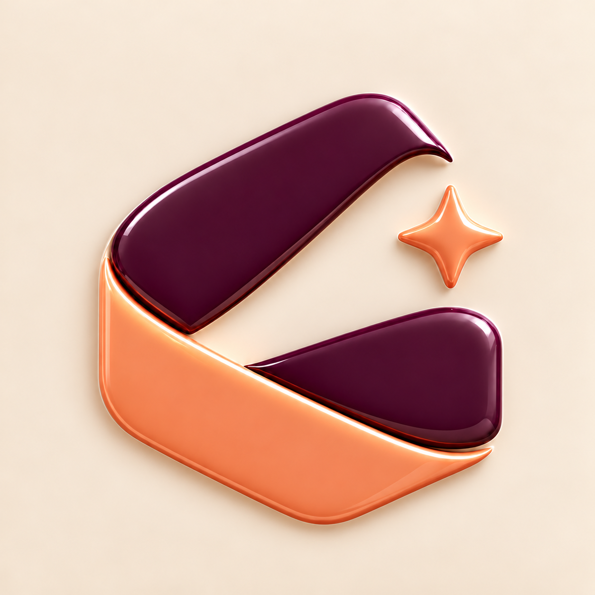
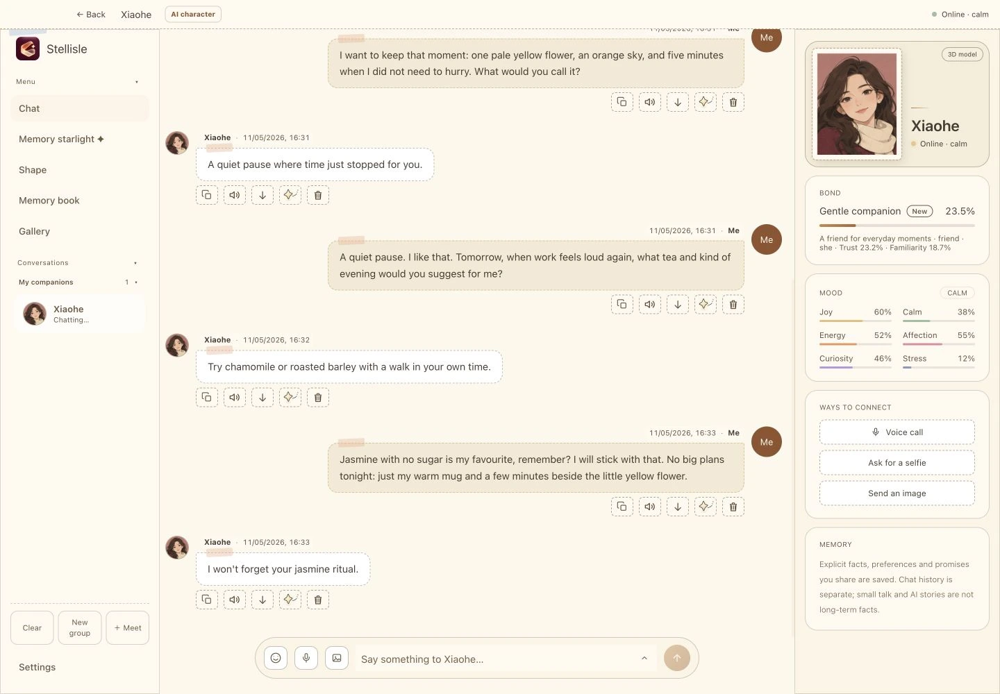
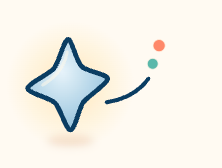
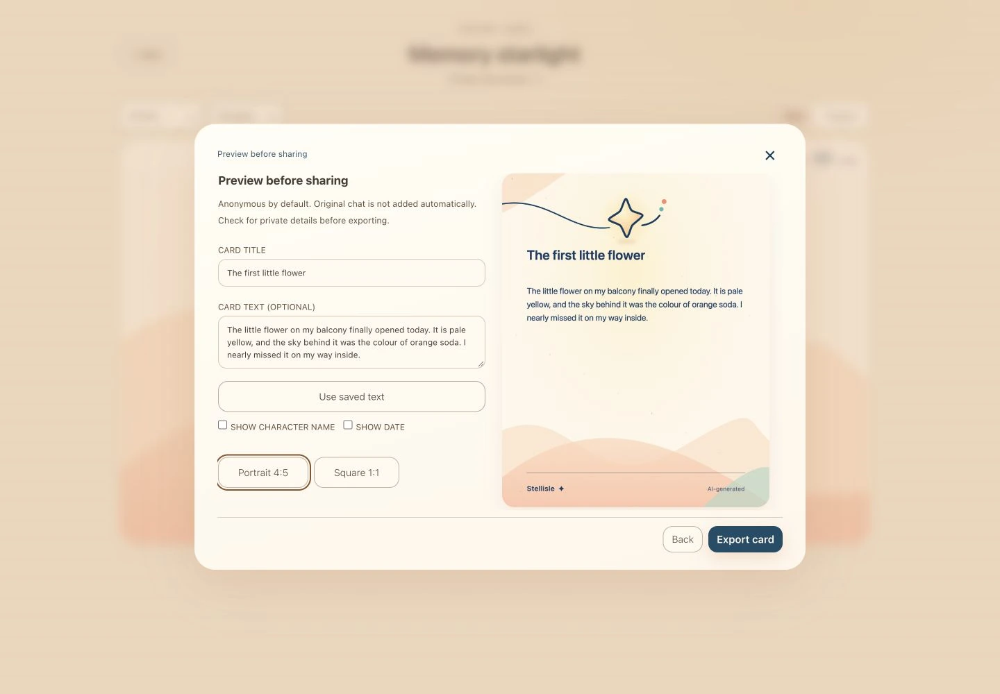

<p align="center">
  
</p>

<h1 align="center">Stellisle Releases</h1>

<p align="center">
  <strong>知屿星信 · macOS 官方发行版、安装包与安全验证中心</strong><br>
  <em>Official distribution hub, binary verification manifests, and changelog records for Stellisle.</em>
</p>

<p align="center">
  <a href="https://stellisle.app"></a> &nbsp;
  <a href="https://discord.gg/9v5yT9kR"></a> &nbsp;
  <a href="https://x.com/stellisle_app"></a>
  <br>
  <a href="https://github.com/stellisle-app/stellisle-releases/releases"></a> &nbsp;
  <a href="https://github.com/stellisle-app/stellisle-releases"></a>
</p>

---

<p align="center">
  
</p>

<p align="center">
  <em>Desktop Workspace: A calm conversational presence resting at the corner of your screen.</em>
</p>

---

## Overview

**Stellisle (知屿星信)** is a native desktop companion designed for macOS on Apple Silicon. It operates as a focused workspace presence, providing contextual conversational memory, nuanced vocal likeness, and tactile skeuomorphic interactions without sending personal telemetry to cloud servers.

This repository serves as the official distribution channel for verified disk images (`.dmg`), release notes, cryptographic checksums, and architecture compatibility requirements.

<p align="center">
  
</p>

---

## Architecture & System Capabilities

### 1. Local Neural Inference
Engineered specifically for Apple Silicon Unified Memory and the Apple Metal compute framework. Conversational generation processes on-device, preserving privacy and keeping spoken exchanges within local storage.

### 2. Encrypted Persistent Memory Graph
Conversations, preferences, and contextual milestones persist across sessions in an encrypted on-device SQLite database. Contextual retrieval reconstructs long-term familiarity over weeks and months of use.

### 3. Tactile Skeuomorphic Desk & Acoustics
Direct developer communication operates through an interactive simulated teleprinter desk. The interface integrates procedurally synthesized dot-matrix printer audio via the Web Audio API, pairing mechanical sound design with real-time ticket dispatch.

<p align="center">
  
</p>

<p align="center">
  <em>Starlight Keepsakes: Procedural client-rendered memory keepsakes.</em>
</p>

---

## Hardware & Operating System Matrix

Stellisle utilizes Apple Metal 3 shaders and ARM64-specific neural kernels. Intel-based Mac configurations and Rosetta 2 emulation are not supported.

| Specification | Minimum Requirement | Recommended Specification |
| :--- | :--- | :--- |
| **Operating System** | macOS 14.0 Sonoma | macOS 15.0+ Sequoia |
| **Processor** | Apple Silicon M1 (8-core CPU / 7-core GPU) | Apple Silicon M2, M3, or M4 |
| **Unified Memory** | 8 GB Unified Memory | 16 GB or higher Unified Memory |
| **Storage Space** | 2.5 GB available APFS storage | 5 GB available APFS storage |
| **Display Support** | Built-in Retina or external 1080p display | Retina 4K / 5K with Wide Color (P3) |

---

## Installation Guide

### Option 1: Standard Disk Image (.dmg)

1. Open the [Releases](https://github.com/stellisle-app/stellisle-releases/releases) directory in this repository.
2. Download the latest release binary: `Stellisle-<version>-arm64.dmg`.
3. Double-click the downloaded `.dmg` file to mount the volume.
4. Drag the `Stellisle.app` bundle into your macOS `/Applications` folder.
5. Eject the disk image and launch Stellisle from Spotlight or Launchpad.

### Option 2: Binary Integrity Verification

Every published `.dmg` file includes a corresponding SHA-256 checksum in its release assets. You can verify package integrity in Terminal:

```bash
shasum -a 256 Stellisle-*.dmg
```

Compare the resulting hash with the published value in the release notes to confirm the archive has not been modified.

---

## Release Channels & Cadence

| Channel | Identifier | Purpose | Distribution Target |
| :--- | :--- | :--- | :--- |
| **Stable** | `vX.Y.Z` | Recommended production releases tested across macOS 14 and 15. | GitHub Releases & [stellisle.app](https://stellisle.app) |
| **Preview** | `vX.Y.Z-rc.*` | Pre-release builds containing newly ported neural backends and audio models. | GitHub Releases (Tagged Pre-release) |

---

## Feedback, Support & Community

- **Interactive Feedback Desk**: Visit [stellisle.app/feedback.html](https://stellisle.app/feedback.html) to submit bug reports and feature suggestions. Submissions receive an automated printout ticket and real-time delivery status.
- **Discord Community**: Join our community server at [discord.gg/9v5yT9kR](https://discord.gg/9v5yT9kR) for installation discussion, hardware benchmarking, and voice model previews.
- **Direct Developer Contact**: Inquiries regarding security, localization, or privacy can be addressed to `stellisle@proton.me`.

---

<p align="center">
  <sub>Copyright © 2026 Stellisle. Built with care for quiet minds.</sub>
</p>
